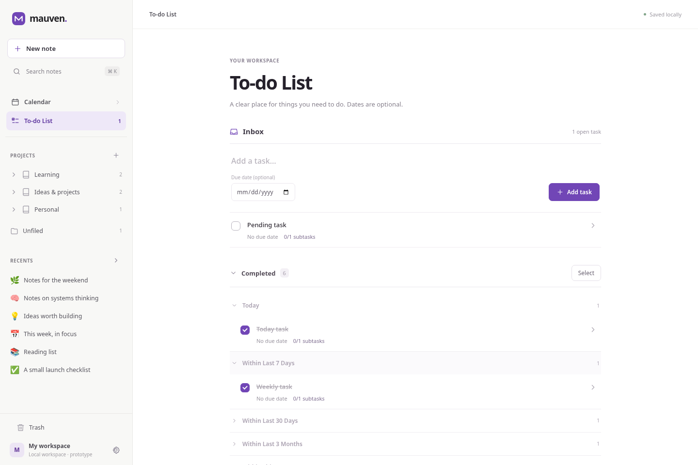

<!-- GitHub-ready release: source code only; do not commit personal notes or browser exports. -->
# Mauven - Frontend Prototype v0.0.1

> A quiet space for your thoughts.




Mauven is a quiet, single-admin notes-and-tasks workspace with an editorial, distraction-free interface. **This repository is a frontend prototype, not a production-secure notes service.** It uses browser `localStorage`, with no backend or login. Keep sensitive information out of this build.

## Try it locally

No build tools or dependencies are required:

```bash
cd mauven
python3 -m http.server 4173
```

Open <http://localhost:4173/>. Alternatively, use any static file server.

## Important limitations of v0.0.1

- **No authentication, server-side permissions, or database.** Anyone using the same browser profile can access its local notes and tasks.
- **Share links are not public links.** They work only in the same browser storage context. Sharing across devices requires a backend, real authorization checks, and persistence in a hosted database.
- Browser storage can be cleared or evicted. Export frequently; there is no automated server backup. Embedded images and icon thumbnails count toward your browser storage quota (often only several MB per origin). If saving fails, export your notes immediately.
- Some copied web images are **external HTTPS links**, not embedded local copies. They may break if the originating site changes or blocks access and may initiate third-party requests when notes are opened. Use screenshot paste or upload to ensure local embedding.
- Direct media and file uploads (PDF, DOCX, video, audio), advanced spreadsheet fidelity, and universal fidelity when pasting from every external editor are **not supported** in this prototype.
- Uploaded icons do **not** go to a server; they are stored in the same browser as the notes. The eventual production implementation will need appropriate durable storage.
- The simple `contenteditable` toolbar uses legacy browser formatting commands. It is suitable for testing layout and workflows, **not for a production editor**. The planned production build uses React, TypeScript, and Tiptap.
- The sanitization here is defense-in-depth for a local demo, not a replacement for server-side sanitization, Content Security Policy, or security review.
- The source can be deployed to a static host **as a demo only**, not as a private production notes app.

Licensed under MIT (see `LICENSE`).
**Browser storage:** The standalone HTML preview and a web-server-hosted copy may have different browser storage origins. To continue using old notes, use the same local origin or export/retain a backup before changing hosting paths. No data migration is needed when run at the same origin.
